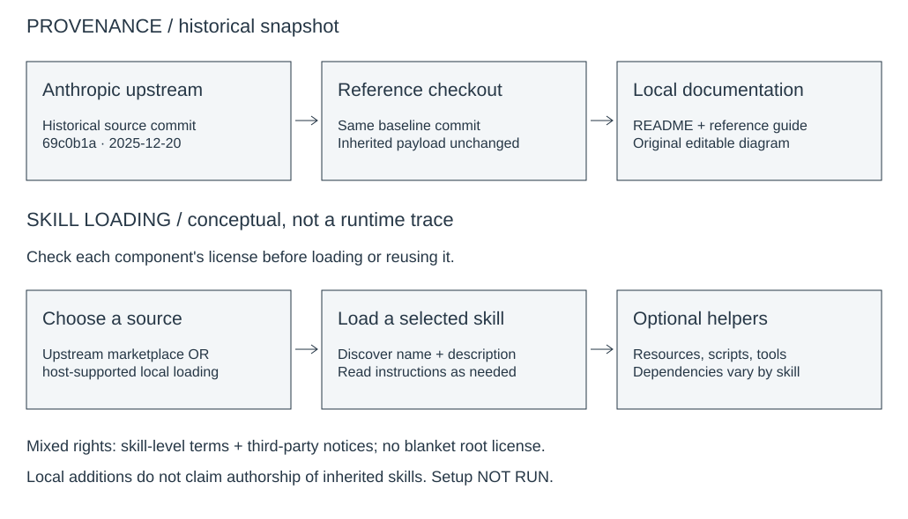

# Reference snapshot and setup boundaries

## Provenance and attribution

The baseline for this documentation cleanup is `main` at **69c0b1a0674149f27b61b2635f935524b6add202**, the December 20, 2025 commit [also present in Anthropic's repository](https://github.com/anthropics/skills/commit/69c0b1a0674149f27b61b2635f935524b6add202). The baseline trees are identical because they are the same Git commit, not because of a repository name or namespace. This establishes a historical upstream reference snapshot; it does not establish current upstream synchronization or GitHub's formal fork relationship.

The local addition is documentation only: the README reference notice, this guide, and the original editable diagram with its matching SVG preview. No skill, script, document, font, manifest, license, or notice is changed. The inherited README remains below the notice and describes the upstream product at the snapshot date; its plan availability and UI instructions are not a current service guarantee.

The bounded baseline history has 17 reachable commits, from October 15 through December 20, 2025. Recorded author names include Keith Lazuka, Matt Piccolella, Mahesh Murag, ant-andi, and Camaris. The baseline tip explicitly records Claude Code generation and Claude co-authorship. Preserve upstream, community, human, and AI attribution in the history and notices; these documentation additions were prepared with Reason. Identity absence does not prove an absence of contributions elsewhere. Reviews, aliases, other branches, and off-repository work are not measured here.

Evidence: [initial commit](https://github.com/anthropics/skills/commit/37292f37bf4bdf33bbd75e415d5313292966e443), [baseline README](https://github.com/anthropics/skills/blob/69c0b1a0674149f27b61b2635f935524b6add202/README.md), and [marketplace manifest](../.claude-plugin/marketplace.json).

## Read licenses per component

There is no tracked root LICENSE at this baseline. Do not infer a blanket Apache license from the README or from a neighboring skill. This guide summarizes source evidence; it does not grant rights or replace the actual terms.

- **Apache-2.0 skill-level licenses:** [algorithmic-art](../skills/algorithmic-art/LICENSE.txt), [brand-guidelines](../skills/brand-guidelines/LICENSE.txt), [canvas-design](../skills/canvas-design/LICENSE.txt), [frontend-design](../skills/frontend-design/LICENSE.txt), [internal-comms](../skills/internal-comms/LICENSE.txt), [mcp-builder](../skills/mcp-builder/LICENSE.txt), [skill-creator](../skills/skill-creator/LICENSE.txt), [slack-gif-creator](../skills/slack-gif-creator/LICENSE.txt), [theme-factory](../skills/theme-factory/LICENSE.txt), [web-artifacts-builder](../skills/web-artifacts-builder/LICENSE.txt), and [webapp-testing](../skills/webapp-testing/LICENSE.txt). Retain applicable notices and identify modifications; separately licensed embedded assets remain separate.
- **Source-available, not open source:** [docx](../skills/docx/LICENSE.txt), [pdf](../skills/pdf/LICENSE.txt), [pptx](../skills/pptx/LICENSE.txt), and [xlsx](../skills/xlsx/LICENSE.txt) have Anthropic service-agreement terms and additional restrictions on copying, derivatives, and distribution. Visibility in GitHub is not standalone reuse permission. Review the actual terms before any use; this cleanup neither copies their payload into new assets nor asserts rights to redistribute it.
- **Unresolved grant:** [doc-coauthoring](../skills/doc-coauthoring/SKILL.md) and the [template](../template/SKILL.md) lack accompanying licenses and frontmatter license declarations at this baseline. Do not assume neighboring Apache terms apply.
- **Third-party assets:** retain [THIRD_PARTY_NOTICES.md](../THIRD_PARTY_NOTICES.md), font OFL files in [canvas-fonts](../skills/canvas-design/canvas-fonts), and embedded schema provenance. The notices identify imageio, imageio-ffmpeg, FFmpeg, Pillow, and font authors under differing terms; they are not proof of installed dependency versions. Exact coverage for every embedded asset, including the Serif font variants, has not been established. Do not broaden a skill-level license to resolve that uncertainty.

The diagram uses only original shapes and short explanatory labels, no inherited scripts, prompts, fonts, document assets, or logos. No new license grant is asserted for this guide or diagram, and no existing component's terms are changed.

## Setup paths — inferred from source, NOT RUN

This repository is a collection of skill folders, not one application. There is no root application build or universal dependency installation.

1. **Read-only reference:** inspect a skill's `SKILL.md`, its license, and any referenced dependencies without activating it. No setup is needed to read the files.
2. **Upstream marketplace:** the inherited README's `/plugin marketplace add anthropics/skills` command registers Anthropic's repository, not `JDKristenson/skills`. The manifest calls the marketplace `anthropic-agent-skills` and groups four document skills and twelve example skills. This guide does not claim a local marketplace install was verified or rename that inherited identity.
3. **Selected local skill:** for a compatible host, follow that host's current documentation for local skill loading. Inspect the selected folder and resolve its license first. Merely cloning this checkout does not register skills, install tools, or launch a service. No unverified host-specific local registration command is supplied here.
4. **Optional helper execution:** requirements differ by skill. For example, [MCP helper requirements](../skills/mcp-builder/scripts/requirements.txt) name Python `anthropic` and `mcp`; [GIF requirements](../skills/slack-gif-creator/requirements.txt) name image libraries; [webapp-testing](../skills/webapp-testing/SKILL.md) describes Python Playwright; the [artifact initializer](../skills/web-artifacts-builder/scripts/init-artifact.sh) requires Node 18+ and can install pnpm and generate a React/TypeScript project. These examples are not a complete environment lockfile. Document utilities reference additional native tools; no document workflow was activated.

No installation, helper execution, provider/API call, build, or runtime test was performed for this documentation cleanup. Source reading and static documentation checks do not establish host compatibility or runtime correctness. Review helpers before executing them: some install dependencies, start processes, change user configuration, or replace generated files. Use isolated environments and synthetic inputs; keep private documents and credentials out of examples and screenshots.

## Diagram and maintenance

Open [provenance.excalidraw](provenance.excalidraw) in a compatible Excalidraw editor to edit the native text, boxes, and arrows. [provenance.svg](provenance.svg) is the matching static preview. The lower flow is conceptual, based on the README and manifest, not a runtime trace or an endorsement of restricted-material reuse. The upper flow distinguishes inherited source from the documentation-only local delta.

Keep both diagram files synchronized when editing. Future upstream imports should identify an exact baseline commit and reassess per-component rights; do not silently replace the reference identity or flatten mixed licenses into a root license. Preserve the inherited README and contributor credits while documenting any independently evidenced local work separately.
